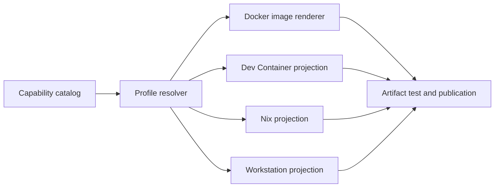

# Realm Architecture

## Purpose and scope

Realm uses a layered, contract-driven architecture. This document owns structural boundaries, dependency direction, integration rules, and current-to-target evolution. Logical responsibilities remain canonical in [SYSTEM.md](SYSTEM.md).

## Layer model

1. **Intent and contracts** — identity, policy, specifications, schemas, and accepted decisions.
2. **Domain** — canonical concepts and pure domain behavior.
3. **Application** — planning, orchestration, use cases, and state transitions.
4. **Adapters** — filesystems, providers, frameworks, renderers, and external tools.
5. **Interfaces** — CLI, library, site, reports, generated artifacts, and automation contracts.
6. **Evidence** — tests, diagnostics, provenance, manifests, and health projections.

Dependencies point inward toward stable contracts and domain behavior. External details do not become canonical domain truth.

## Structural view

The diagram is conceptual. [SYSTEM.md](SYSTEM.md) remains authoritative for responsibilities and implementation evidence determines current availability.

## Portable container-development boundary

The open Dev Container Specification is the portable container-development
interface where applicable. Realm capability profiles and the resolved manifest
remain canonical; Docker, Dev Container, Nix and workstation outputs are parallel
projections rather than a required chain through one editor or host.

The [versioned boundary mapping](catalog/devcontainer-boundary.v1.json) assigns
portable properties, consumer overlays and host adapters explicitly. Editor
customizations stay namespaced; Codespaces-specific permissions, machine
selection and prebuild behavior do not become portable capability policy.
[ADR-0004](DECISIONS.md#adr-0004-project-canonical-profiles-to-the-dev-container-standard)
compares authored JSON, Realm projection and optional devenv generation.

The [boundary guide](docs/devcontainer-boundary.md) distinguishes the authored
reference, official schema validation, CLI interpretation, container execution,
shared tooling and actual IDE/cloud qualification. Issue #39 defines this
mapping checkpoint; issue #10 owns emitted projections and the generated canary,
after which #39 can complete host proof. Sanctuary consumes the same contract
without maintaining an independent implementation.

## Dependency rules

- Sibling domain capabilities integrate through versioned public contracts, not direct access to internals.
- Generated artifacts never become the canonical source unless an accepted decision explicitly changes ownership.
- Provider and platform adapters depend on application ports; core behavior does not depend on a provider implementation.
- Read, plan, apply, verify, publish, and recover remain separate authority boundaries when consequential.
- Cross-repository references use releases, immutable commits, schemas, packages, or documented APIs rather than mutable default-branch assumptions.

## Ecosystem interfaces

- Mantle shell
- Empathy Dev Container baseline
- Holon manifests
- Relay image publication
- future Firmament infrastructure

## Deployment and portability

The architecture favors independently usable local and self-hosted operation. Optional managed services may add availability, collaboration, support, and hosted infrastructure without becoming the canonical holder of portable state.

## Evidence and uncertainty

- **Observed:** The repository README establishes the intended boundary as a reproducible developer-workstation and self-hosted runtime foundation driven by versioned capabilities and profiles; significant implementation remains incomplete.
- **Decided for this draft:** The repository owns the bounded concern described here and participates through versioned contracts.
- **Proposed:** Target systems and later roadmap phases remain proposals until accepted and implemented.
- **Open question:** Which parts of this draft should become active in the first independently versioned release?
